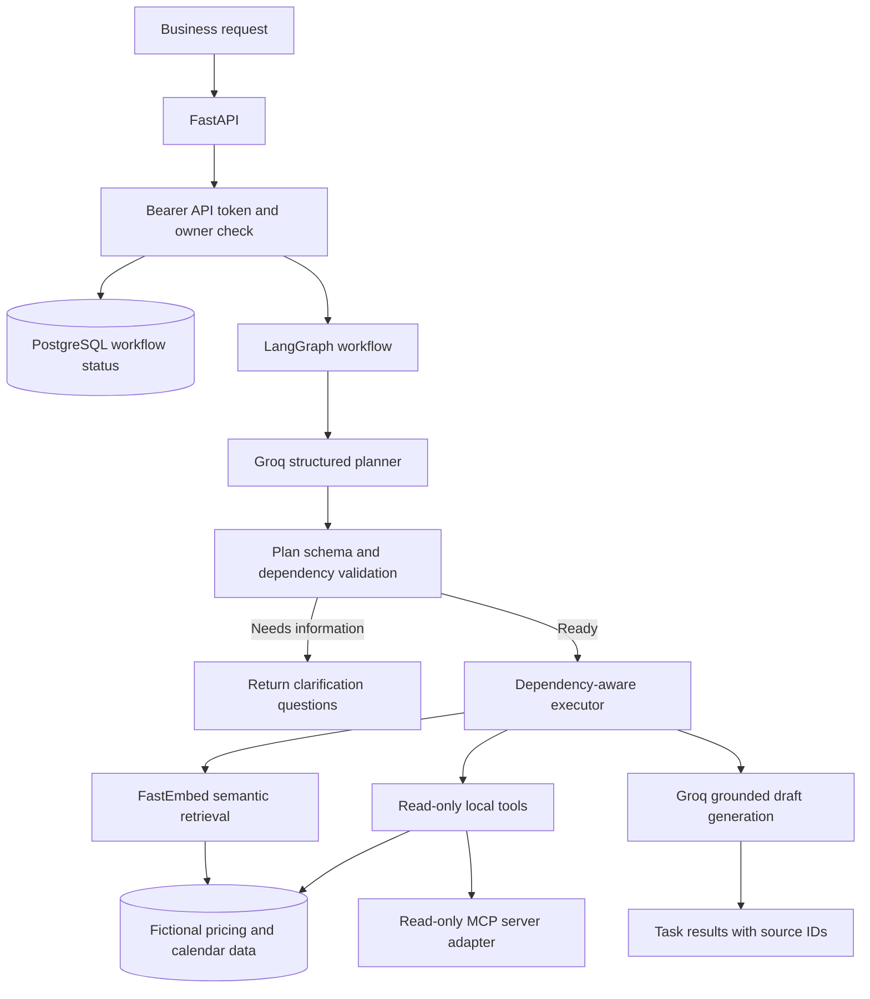

# WorkFlow AI

WorkFlow AI is a backend-first workflow engine that turns a business request into a validated task plan, checks task dependencies, retrieves relevant fictional business data, and produces grounded drafts. It is built to demonstrate practical AI engineering patterns with FastAPI, LangGraph, Groq, FastEmbed, PostgreSQL, SQLAlchemy, Alembic, MCP, and pytest.

## What it demonstrates

- Structured LLM planning and Pydantic validation
- Dependency ordering, readiness routing, failure isolation, and duplicate-run protection
- Read-only local tools exposed through an MCP server
- Semantic retrieval with document chunks, embeddings, cosine similarity, and source IDs
- Proposal and email drafts grounded in retrieved source documents
- Versioned regression evaluations with measured retrieval and citation-integrity results
- Opt-in LangSmith traces, request IDs, bounded provider retries, and timeouts
- A single configured API identity with separate API and workflow-executor tokens

All business records are fictional. Calendar tools only read the local sample dataset, and generated emails or proposals remain drafts. The project does not send email or write to a live calendar.

## Architecture



The API owns workflow persistence and access checks. LangGraph runs the planning and execution nodes. The executor only starts after the plan passes validation; failed prerequisites skip dependent tasks while independent tasks can continue. Retrieval and MCP both use the same local read-only tool layer.

## Local setup

Requirements: Python 3.12, `uv`, and Docker with Compose. The first semantic retrieval run downloads the small FastEmbed model; subsequent runs use its local cache.

From PowerShell:

```powershell
Set-Location backend
Copy-Item .env.example .env
```

Edit `backend/.env` and set `POSTGRES_PASSWORD`, `GROQ_API_KEY`, `WORKFLOW_API_TOKEN`, and `WORKFLOW_EXECUTOR_TOKEN`. Generate two different random tokens on your machine with:

```powershell
python -c "import secrets; print(secrets.token_urlsafe(32))"
```

Keep the generated values in `backend/.env`; do not commit that file. Tracing stays disabled unless `LANGSMITH_TRACING=true` and `LANGSMITH_API_KEY` are configured.

Then start the database, apply migrations, provision the configured single-user identity, and start the API:

```powershell
uv sync --locked
docker compose up -d db
uv run alembic upgrade head
uv run python -m app.bootstrap_user
uv run uvicorn app.main:app --reload
```

The database image is `pgvector/pgvector:pg17-trixie` (PostgreSQL 17 with pgvector, on the same Debian release as the official `postgres:17` image so existing volumes keep matching collations). Retrieval runs in memory by default. To serve it from PostgreSQL instead, load a corpus into the `document_chunks` table (HNSW cosine index plus a generated `tsvector` with a GIN index) and switch the backend:

```powershell
uv run python -m app.rag.ingest --corpus pricing-mock            # fictional data for workflow tools
uv run python -m app.rag.ingest --corpus stack-docs              # documentation corpus
uv run python -m app.rag.ingest --corpus stack-docs --chunk-size 300 --overlap 45
uv run python -m app.rag.ingest --corpus stack-docs --dry-run    # report changes only
```

Then set `RAG_RETRIEVER=pgvector` in `backend/.env`; the workflow tools query the `pricing-mock` corpus. Ingestion is idempotent and scoped to one corpus: unchanged chunks are not re-embedded, changed chunks are updated in place, and chunks removed from that corpus are deleted, all in one transaction. The stored embedding-model identity includes the downloaded FastEmbed snapshot revision (for example `BAAI/bge-small-en-v1.5@aa8f8b060edb`), because FastEmbed does not pin model revisions; if a cache refresh pulls a different snapshot, the next ingestion re-embeds instead of mixing vectors.

### Retrieval corpus

`stack-docs` is a realistic retrieval corpus of **227 documentation pages** (1.7 MB of cleaned text, 1,364 chunks at the default chunk size) from three MIT-licensed projects in this stack, each pinned to a commit:

| Collection | Pages | Source | License |
| --- | ---: | --- | --- |
| FastAPI | 120 | [fastapi/fastapi](https://github.com/fastapi/fastapi) `docs/en/docs` | MIT |
| Pydantic | 51 | [pydantic/pydantic](https://github.com/pydantic/pydantic) `docs` | MIT |
| SQLModel | 56 | [fastapi/sqlmodel](https://github.com/fastapi/sqlmodel) `docs` | MIT |

The corpus file is [`backend/app/rag/data/stack_docs_corpus.v1.json`](backend/app/rag/data/stack_docs_corpus.v1.json); commit SHAs, copyright lines, and full license texts are in [`THIRD_PARTY_NOTICES.md`](backend/app/rag/data/THIRD_PARTY_NOTICES.md). [`app/rag/build_corpus.py`](backend/app/rag/build_corpus.py) regenerates it from local checkouts. Cleaning removes build macros, code-include directives (so examples that live in separate source files are not in the corpus), heading anchors, HTML, API-reference stubs, changelogs, internal `_`-prefixed files, and pages under 80 words; inline fenced code is kept. The fictional pricing and calendar data stays as the source for the workflow tools.

Documentation pages use token-aware, sentence-aware chunking: text is split into headings, sentences, and whole fenced code blocks, then packed up to `RAG_CHUNK_TOKENS` (default 400) counted with the embedding model's own WordPiece tokenizer, since bge-small-en-v1.5 truncates at 512 tokens. Each chunk starts with whole trailing sentences from the previous chunk, up to `RAG_CHUNK_OVERLAP_TOKENS` (default 60, i.e. 15%); a boundary after a sentence or code block longer than that budget gets no overlap rather than a mid-sentence cut. Each chunk is prefixed with `collection | page title > section`. The fictional pricing corpus keeps the original word chunker so the v1 evaluation stays comparable.

The API documentation is at <http://127.0.0.1:8000/docs>; the health endpoint is <http://127.0.0.1:8000/health>.

The default `WORKFLOW_USER_ID` is a fixed demo identity. If you change it, run the bootstrap command again after migrations. API access is intentionally single-user: the API bearer token maps to that configured identity, and the separate executor token is required for workflow execution and direct status updates. This is a small demo access gate, not a replacement for an identity provider in a public multi-user deployment.

## Try the workflow API

Create a workflow with the API token:

```bash
curl -X POST http://127.0.0.1:8000/api/v1/workflows/ \
  -H "Authorization: Bearer <WORKFLOW_API_TOKEN>" \
  -H "Content-Type: application/json" \
  -d '{"original_request":"Prepare a proposal for Northstar Labs using previous pricing and draft a follow-up email."}'
```

Then execute it with both tokens, replacing `<WORKFLOW_ID>` with the returned ID:

```bash
WORKFLOW_ID="<WORKFLOW_ID>"
curl -X POST "http://127.0.0.1:8000/api/v1/workflows/${WORKFLOW_ID}/execute" \
  -H "Authorization: Bearer <WORKFLOW_API_TOKEN>" \
  -H "X-Workflow-Executor-Token: <WORKFLOW_EXECUTOR_TOKEN>"
```

The response includes the plan, dependency order, task statuses, draft output, and source IDs. A repeated execution request is rejected after the workflow leaves `PLANNING`. Draft wording varies; here is an abbreviated response excerpt:

```json
{
  "workflow_id": "11111111-1111-4111-8111-111111111111",
  "status": "COMPLETED",
  "planning_outcome": "READY",
  "summary": "Prepare a proposal",
  "missing_information": [],
  "tasks": [
    {"task_id": "T1", "task_type": "retrieve_documents", "description": "Find Northstar pricing", "depends_on": []},
    {"task_id": "T2", "task_type": "draft_email", "description": "Draft follow-up", "depends_on": ["T1"]}
  ],
  "execution_order": ["T1", "T2"],
  "execution_results": [
    {"task_id": "T1", "status": "SIMULATED", "source_ids": ["mock-pricing-001"]},
    {"task_id": "T2", "status": "SIMULATED", "source_ids": ["mock-pricing-001"]}
  ]
}
```

## Run the local MCP tools

From `backend`:

```powershell
uv run python -m app.workflow_engine.mcp_server
```

The server uses stdio and exposes `search_pricing_documents` and `check_calendar_availability`. Both read fictional local data only.

## Evaluation and tests

Run the backend test suite:

```powershell
uv run pytest -q
```

Run the versioned evaluation set and write a fresh report:

```powershell
uv run python -m app.evaluation.run --output evaluation/results-v1.json
```

Evaluation dataset: [`backend/app/evaluation/dataset.v1.json`](backend/app/evaluation/dataset.v1.json). Captured results: [`backend/evaluation/results-v1.json`](backend/evaluation/results-v1.json).

The recorded run passed 11/11 checks: plan validation 3/3, dependency execution 2/2, citation integrity 2/2, and retrieval 4/4. On the three positive retrieval queries, Hit@1 and precision@3 were both 3/3; the unrelated query returned no matches. These are small synthetic regression checks, not broad benchmark scores. Planning cases validate known plan fixtures rather than live Groq output, and citation checks verify source IDs rather than the truth of every sentence.

### RAG evaluation v2

The v2 set measures retrieval and grounded answering on the `stack-docs` corpus. v1 is unchanged and still runs as above.

```powershell
uv run python -m app.rag.ingest --corpus stack-docs
uv run python -m app.evaluation.run_v2 --config vector                    # retrieval + generation
uv run python -m app.evaluation.run_v2 --config vector --skip-generation  # retrieval only, no Groq calls
```

Each run writes `backend/evaluation/results-v2-<config>.json` with the dataset and corpus SHA-256, embedding-model snapshot, git commit, PostgreSQL and pgvector versions, per-query results, and judge rationales.

**Dataset** ([`dataset.v2.json`](backend/app/evaluation/dataset.v2.json)): 80 queries, each with a question, relevant source IDs, and a reference answer.

| Category | Queries | What it tests |
| --- | ---: | --- |
| Easy | 25 | Wording close to the source page |
| Paraphrased | 25 | The need described without the page's key terms |
| Multi-hop | 15 | Facts from two pages, often across FastAPI, Pydantic, and SQLModel |
| Unanswerable | 15 | Plausible for this stack but absent from the corpus |

Questions were drafted with an LLM assistant from passages found by searching the corpus, then made checkable: every answerable item carries verbatim evidence quotes, and every unanswerable item carries an `absence_pattern`. A test fails if any quote is missing from its cited page or any absence pattern matches a corpus page. Relevance labels were audited against the pooled top-5 pages of dense and full-text retrieval before any metric was recorded; 11 labels were added where a pooled page explicitly stated a required fact (99 labels in total).

**Metrics.** Retrieval is scored per page: chunk results are collapsed to their source page, and recall@1/3/5, MRR@10, and nDCG@5 (binary relevance) are averaged over the 65 answerable queries. Latency is the wall time of one `retrieve()` call, including CPU query embedding, after 3 warm-up queries. Generation uses the top 5 chunks as context for `openai/gpt-oss-20b` (the app's model), and `openai/gpt-oss-120b` judges each answer at temperature 0:

- **Faithfulness:** share of the answer's atomic claims supported by the context.
- **Answer relevance:** 1-5.
- **Answer correctness:** 1-5 against the reference answer; an abstention on an answerable question scores 1.

Citation integrity is checked deterministically: cited IDs must be in the given context, answers must cite something, and the rate of citing a gold page is reported. Abstention is measured on both unanswerable and answerable queries.

**Baseline results: dense vector retrieval (config A).** Source: [`backend/evaluation/results-v2-vector.json`](backend/evaluation/results-v2-vector.json), recorded at commit `d0427cf` with a clean tree, `BAAI/bge-small-en-v1.5@aa8f8b060edb`, PostgreSQL 17.12, and pgvector 0.8.7.

| Queries | recall@1 | recall@3 | recall@5 | MRR@10 | nDCG@5 |
| --- | ---: | ---: | ---: | ---: | ---: |
| All answerable (65) | 0.554 | 0.756 | 0.810 | 0.805 | 0.764 |
| Easy (25) | 0.740 | 0.900 | 0.900 | 0.913 | 0.892 |
| Paraphrased (25) | 0.480 | 0.633 | 0.700 | 0.655 | 0.621 |
| Multi-hop (15) | 0.367 | 0.722 | 0.844 | 0.872 | 0.788 |

Retrieval latency over 80 queries: p50 26.1 ms, p95 32.2 ms. An earlier uncommitted run of the same code on the same machine measured p50 35.6 ms and p95 67.0 ms, so treat these as single-machine figures that vary by tens of percent between runs.

What the baseline shows:

- **Paraphrased queries are the weak spot.** recall@5 is 0.70, against 0.90 when the wording matches the page.
- **Multi-hop recall@1 is capped at 0.5** by definition, since one result can hold only one of two required pages. recall@5 (0.844) is the more useful number there.
- **Unanswerable questions can't be filtered by a score threshold.** Their mean top chunk score (0.754) sits close to the answerable mean (0.820), so dense scores alone can't tell them apart; abstention has to come from the generator.

**Generation results are not recorded yet.** The Groq free tier allows 200,000 tokens per model per day, and one full pass needs more than that for the judge alone. A first attempt hit the limit for both models after 34 answers and 18 judgments; that partial run was discarded rather than reported. The runner now uses low reasoning effort and `--resume`, which reuses finished cases (same dataset, models, prompts, and retrieved context), so a pass can span the daily limit:

```powershell
uv run python -m app.evaluation.run_v2 --config vector --pace 1 --resume
```

CI runs locked dependency installation, database migrations, and the full backend test suite on pushes to `main` and pull requests. Tests use fake embedding and drafting components, so they do not need Groq or LangSmith credentials.

## Observability and data handling

LangSmith tracing is off by default. To enable it, set `LANGSMITH_TRACING=true`, `LANGSMITH_API_KEY`, and optionally `LANGSMITH_PROJECT`. Traces can include prompts, workflow requests, retrieved documents, and model outputs; use only data permitted by your organization’s tracing policy. The API logs request ID, method, path, status, duration, and error type without logging authorization headers or exception text.

## Scope

This repository is a focused AI workflow backend, not a complete SaaS product. It has no frontend, multi-user identity provider, live email/calendar integration, or external write tools. The local API token configuration is intended for a single-user demonstration; production exposure requires an appropriate identity provider and deployment-specific secret management.
