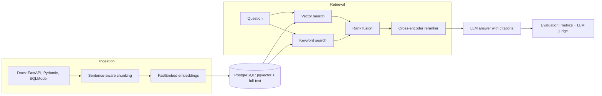
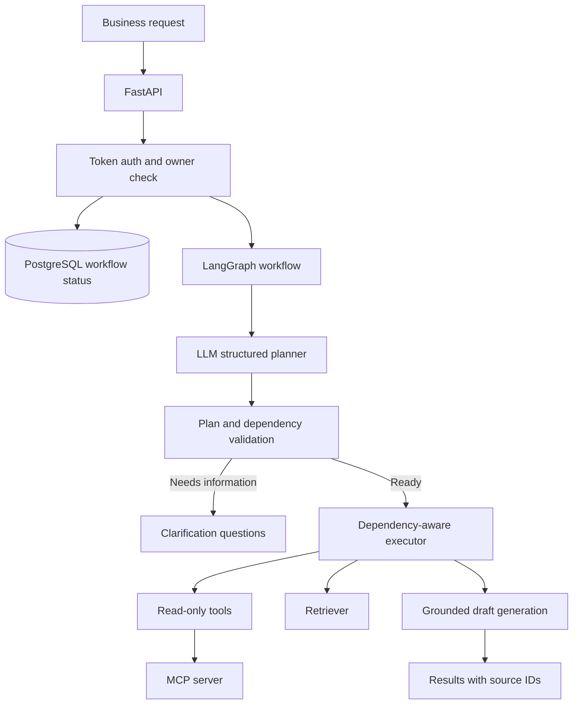

# WorkFlow AI

[](https://github.com/Prashil001/WorkFLow-AI/actions/workflows/backend-ci.yml)

**An AI workflow engine with a measured retrieval-augmented generation (RAG) system.** It turns a business request into a validated task plan, retrieves relevant documents, and drafts answers that cite their sources. Retrieval quality is measured on a versioned evaluation set, with statistical confidence intervals.

**Stack:** Python · FastAPI · LangGraph · PostgreSQL + pgvector · FastEmbed · Groq LLMs · SQLAlchemy · Alembic · MCP · pytest · GitHub Actions

## Results

Measured on an 80-question evaluation set over 227 pages of FastAPI, Pydantic, and SQLModel documentation:

| Retrieval setup | recall@5 | nDCG@5 | Median latency |
| --- | ---: | ---: | ---: |
| Vector search (baseline) | 0.810 | 0.764 | 26 ms |
| Hybrid search (vector + keyword) | 0.877 | 0.763 | 53 ms |
| Hybrid + small reranker (MiniLM) | 0.874 | 0.808 | 1.56 s |
| **Hybrid + reranker (bge-reranker-base)** | **0.892** | **0.820** | 8.18 s |

- **Better retrieval:** the full pipeline lifts recall@5 by +0.082 and nDCG@5 by +0.056 over plain vector search. Both gains are statistically resolved: their 95% confidence intervals exclude zero.
- **A clear trade-off:** reranking improves quality but is slow on a laptop CPU. The small MiniLM reranker keeps most of the gain at about a fifth of the latency.
- **Honest reporting:** every number comes from a saved results file in [`backend/evaluation/`](backend/evaluation/). Gains that the data cannot resolve are reported as such.

recall@5 = share of relevant pages found in the top 5 results. nDCG@5 = how high the relevant pages are ranked. Full method, per-category results, and confidence intervals: **[docs/rag-evaluation.md](docs/rag-evaluation.md)**.

## What's inside

**RAG retrieval**

- PostgreSQL with **pgvector** (HNSW index) for semantic search and built-in **full-text search** (GIN index) for keyword matching.
- **Hybrid search** that merges both result lists with Reciprocal Rank Fusion, plus **cross-encoder reranking**.
- **Idempotent ingestion:** re-running it skips unchanged content, updates what changed, and removes what was deleted.
- **Token-aware chunking** that respects sentence and code-block boundaries.
- All retrievers share one interface, so they can be swapped or combined without changing calling code.

**Evaluation**

- **80 questions** in four types: easy, paraphrased, multi-hop (needs two documents), and unanswerable.
- Every expected answer is **checked against the corpus by automated tests** (verbatim evidence quotes).
- Metrics: recall@k, MRR, nDCG, latency percentiles, and **bootstrap confidence intervals**.
- Answer quality: an **LLM-as-judge** for faithfulness and correctness, plus citation and abstention checks.
- A **CI smoke test** runs real retrieval on every push and fails if quality drops.

**Workflow engine**

- An LLM planner produces structured task plans, validated with Pydantic, with dependency ordering.
- **LangGraph** execution with failure isolation: failed tasks skip their dependents while independent tasks continue.
- Grounded drafts cite their source IDs. Read-only tools are also exposed through an **MCP server**.
- FastAPI service with token authentication, request logging, retries, timeouts, and optional LangSmith tracing.

## Architecture



<details>
<summary>Workflow engine diagram</summary>



</details>

## Quick start

Requirements: Python 3.12, [uv](https://docs.astral.sh/uv/), and Docker.

```powershell
cd backend
Copy-Item .env.example .env     # then set POSTGRES_PASSWORD, GROQ_API_KEY, WORKFLOW_API_TOKEN, WORKFLOW_EXECUTOR_TOKEN
uv sync --locked
docker compose up -d db
uv run alembic upgrade head
uv run python -m app.bootstrap_user
uv run uvicorn app.main:app --reload    # API docs at http://127.0.0.1:8000/docs
```

Load the documentation corpus and run the retrieval evaluation:

```powershell
uv run python -m app.rag.ingest --corpus stack-docs
uv run python -m app.evaluation.run_v2 --config hybrid-rerank --skip-generation
uv run pytest -q
```

Generate the API tokens with `python -c "import secrets; print(secrets.token_urlsafe(32))"`, and keep `.env` out of version control.

<details>
<summary>Try the workflow API</summary>

Create a workflow:

```bash
curl -X POST http://127.0.0.1:8000/api/v1/workflows/ \
  -H "Authorization: Bearer <WORKFLOW_API_TOKEN>" \
  -H "Content-Type: application/json" \
  -d '{"original_request":"Prepare a proposal for Northstar Labs using previous pricing and draft a follow-up email."}'
```

Execute it:

```bash
curl -X POST "http://127.0.0.1:8000/api/v1/workflows/<WORKFLOW_ID>/execute" \
  -H "Authorization: Bearer <WORKFLOW_API_TOKEN>" \
  -H "X-Workflow-Executor-Token: <WORKFLOW_EXECUTOR_TOKEN>"
```

The response contains the plan, the execution order, each task's status, the draft, and source IDs such as `mock-pricing-001`. Run the MCP server with `uv run python -m app.workflow_engine.mcp_server`. Workflow data is fictional, and drafts are never sent anywhere.

</details>

## Project structure

```text
backend/
  app/
    api/               FastAPI routes and auth
    workflow_engine/   planner, LangGraph graph, executor, tools, MCP server
    rag/               corpus builder, ingestion, pgvector / hybrid / reranking retrievers
    evaluation/        datasets, evaluation runner, metrics, LLM judge, comparison, CI smoke test
  evaluation/          saved results files
  migrations/          Alembic schema migrations
  tests/               pytest suite
docs/
  rag-evaluation.md    full evaluation method and results
```

## Limitations

- **Small evaluation set.** 80 questions over one corpus. Some differences between setups are within noise; the [full write-up](docs/rag-evaluation.md#limitations) marks which.
- **Answer-quality scores are pending.** The LLM-judge pipeline is built, but the free Groq tier's daily token limit hasn't allowed a complete run yet.
- **Reranking is slow without a GPU.** About 8 s per query with the larger model on a laptop CPU.
- **The keyword search is not BM25.** Postgres ranking has no IDF, which likely explains why hybrid search alone ranks the top result worse.
- **Demo scope.** Single-user authentication and fictional business data; the hybrid pipeline is evaluated on the docs corpus, not yet wired into the workflow API.

## Data and licenses

The evaluation corpus is cleaned text from the FastAPI, Pydantic, and SQLModel documentation, all MIT-licensed. Source commits and full license texts are in [`THIRD_PARTY_NOTICES.md`](backend/app/rag/data/THIRD_PARTY_NOTICES.md).
