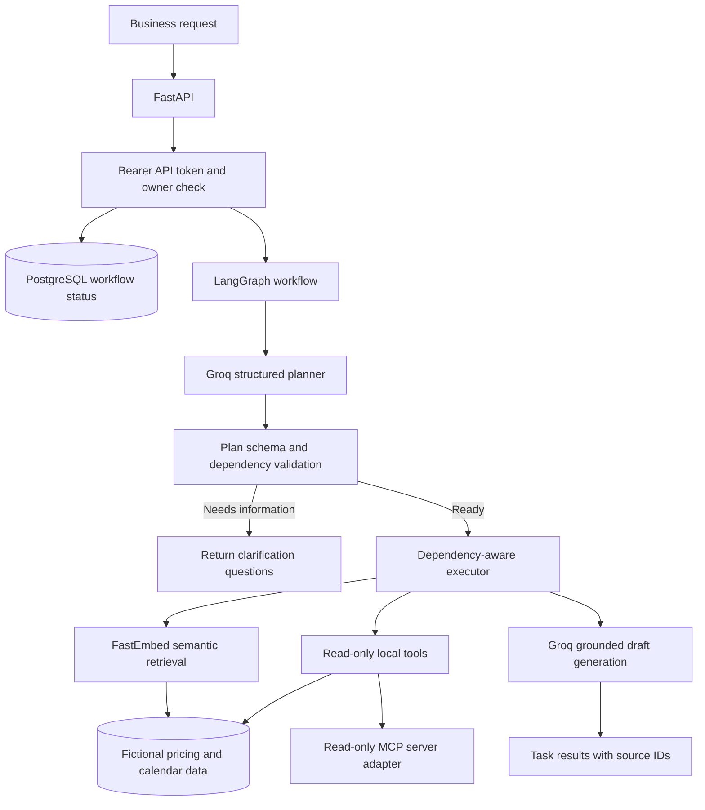

# WorkFlow AI

WorkFlow AI is a backend-first workflow engine that turns a business request into a validated task plan, checks task dependencies, retrieves relevant fictional business data, and produces grounded drafts. It is built to demonstrate practical AI engineering patterns with FastAPI, LangGraph, Groq, FastEmbed, PostgreSQL, SQLAlchemy, Alembic, MCP, and pytest.

## What it demonstrates

- Structured LLM planning and Pydantic validation
- Dependency ordering, readiness routing, failure isolation, and duplicate-run protection
- Read-only local tools exposed through an MCP server
- Semantic retrieval with document chunks, embeddings, cosine similarity, and source IDs
- Proposal and email drafts grounded in retrieved source documents
- Versioned regression evaluations with measured retrieval and citation-integrity results
- Opt-in LangSmith traces, request IDs, bounded provider retries, and timeouts
- A single configured API identity with separate API and workflow-executor tokens

All business records are fictional. Calendar tools only read the local sample dataset, and generated emails or proposals remain drafts. The project does not send email or write to a live calendar.

## Architecture



The API owns workflow persistence and access checks. LangGraph runs the planning and execution nodes. The executor only starts after the plan passes validation; failed prerequisites skip dependent tasks while independent tasks can continue. Retrieval and MCP both use the same local read-only tool layer.

## Local setup

Requirements: Python 3.12, `uv`, and Docker with Compose. The first semantic retrieval run downloads the small FastEmbed model; subsequent runs use its local cache.

From PowerShell:

```powershell
Set-Location backend
Copy-Item .env.example .env
```

Edit `backend/.env` and set `POSTGRES_PASSWORD`, `GROQ_API_KEY`, `WORKFLOW_API_TOKEN`, and `WORKFLOW_EXECUTOR_TOKEN`. Generate two different random tokens on your machine with:

```powershell
python -c "import secrets; print(secrets.token_urlsafe(32))"
```

Keep the generated values in `backend/.env`; do not commit that file. Tracing stays disabled unless `LANGSMITH_TRACING=true` and `LANGSMITH_API_KEY` are configured.

Then start the database, apply migrations, provision the configured single-user identity, and start the API:

```powershell
uv sync --locked
docker compose up -d db
uv run alembic upgrade head
uv run python -m app.bootstrap_user
uv run uvicorn app.main:app --reload
```

The API documentation is at <http://127.0.0.1:8000/docs>; the health endpoint is <http://127.0.0.1:8000/health>.

The default `WORKFLOW_USER_ID` is a fixed demo identity. If you change it, run the bootstrap command again after migrations. API access is intentionally single-user: the API bearer token maps to that configured identity, and the separate executor token is required for workflow execution and direct status updates. This is a small demo access gate, not a replacement for an identity provider in a public multi-user deployment.

## Try the workflow API

Create a workflow with the API token:

```bash
curl -X POST http://127.0.0.1:8000/api/v1/workflows/ \
  -H "Authorization: Bearer <WORKFLOW_API_TOKEN>" \
  -H "Content-Type: application/json" \
  -d '{"original_request":"Prepare a proposal for Northstar Labs using previous pricing and draft a follow-up email."}'
```

Then execute it with both tokens, replacing `<WORKFLOW_ID>` with the returned ID:

```bash
WORKFLOW_ID="<WORKFLOW_ID>"
curl -X POST "http://127.0.0.1:8000/api/v1/workflows/${WORKFLOW_ID}/execute" \
  -H "Authorization: Bearer <WORKFLOW_API_TOKEN>" \
  -H "X-Workflow-Executor-Token: <WORKFLOW_EXECUTOR_TOKEN>"
```

The response includes the plan, dependency order, task statuses, draft output, and source IDs. A repeated execution request is rejected after the workflow leaves `PLANNING`. Draft wording varies; here is an abbreviated response excerpt:

```json
{
  "workflow_id": "11111111-1111-4111-8111-111111111111",
  "status": "COMPLETED",
  "planning_outcome": "READY",
  "summary": "Prepare a proposal",
  "missing_information": [],
  "tasks": [
    {"task_id": "T1", "task_type": "retrieve_documents", "description": "Find Northstar pricing", "depends_on": []},
    {"task_id": "T2", "task_type": "draft_email", "description": "Draft follow-up", "depends_on": ["T1"]}
  ],
  "execution_order": ["T1", "T2"],
  "execution_results": [
    {"task_id": "T1", "status": "SIMULATED", "source_ids": ["mock-pricing-001"]},
    {"task_id": "T2", "status": "SIMULATED", "source_ids": ["mock-pricing-001"]}
  ]
}
```

## Run the local MCP tools

From `backend`:

```powershell
uv run python -m app.workflow_engine.mcp_server
```

The server uses stdio and exposes `search_pricing_documents` and `check_calendar_availability`. Both read fictional local data only.

## Evaluation and tests

Run the backend test suite:

```powershell
uv run pytest -q
```

Run the versioned evaluation set and write a fresh report:

```powershell
uv run python -m app.evaluation.run --output evaluation/results-v1.json
```

Evaluation dataset: [`backend/app/evaluation/dataset.v1.json`](backend/app/evaluation/dataset.v1.json). Captured results: [`backend/evaluation/results-v1.json`](backend/evaluation/results-v1.json).

The recorded run passed 11/11 checks: plan validation 3/3, dependency execution 2/2, citation integrity 2/2, and retrieval 4/4. On the three positive retrieval queries, Hit@1 and precision@3 were both 3/3; the unrelated query returned no matches. These are small synthetic regression checks, not broad benchmark scores. Planning cases validate known plan fixtures rather than live Groq output, and citation checks verify source IDs rather than the truth of every sentence.

CI runs locked dependency installation, database migrations, and the full backend test suite on pushes to `main` and pull requests. Tests use fake embedding and drafting components, so they do not need Groq or LangSmith credentials.

## Observability and data handling

LangSmith tracing is off by default. To enable it, set `LANGSMITH_TRACING=true`, `LANGSMITH_API_KEY`, and optionally `LANGSMITH_PROJECT`. Traces can include prompts, workflow requests, retrieved documents, and model outputs; use only data permitted by your organization’s tracing policy. The API logs request ID, method, path, status, duration, and error type without logging authorization headers or exception text.

## Scope

This repository is a focused AI workflow backend, not a complete SaaS product. It has no frontend, multi-user identity provider, live email/calendar integration, or external write tools. The local API token configuration is intended for a single-user demonstration; production exposure requires an appropriate identity provider and deployment-specific secret management.
